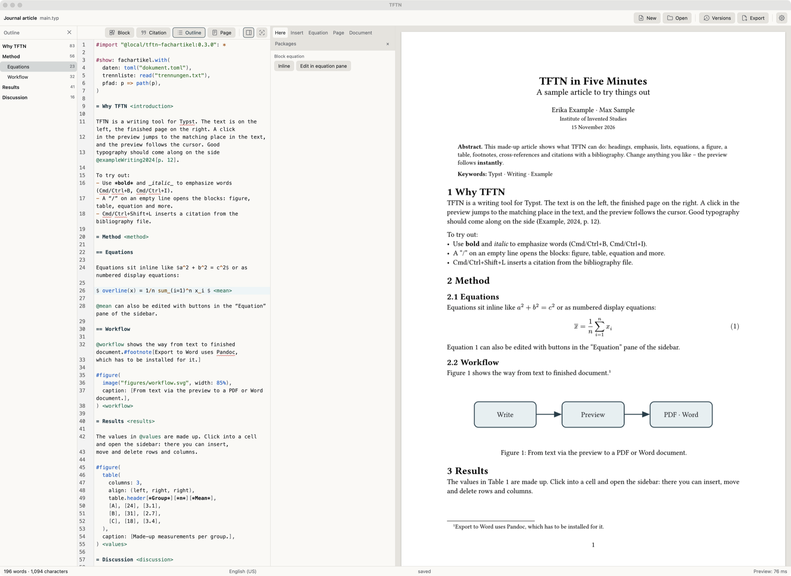
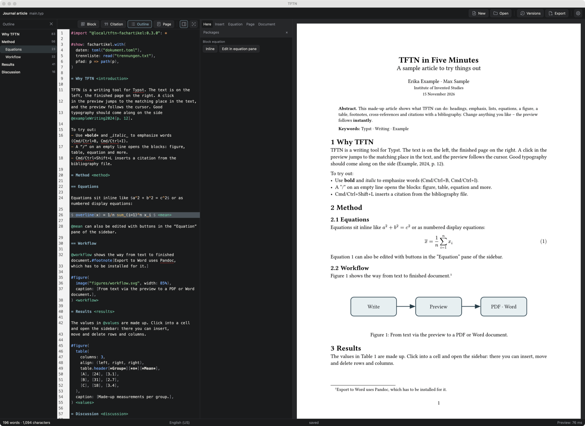
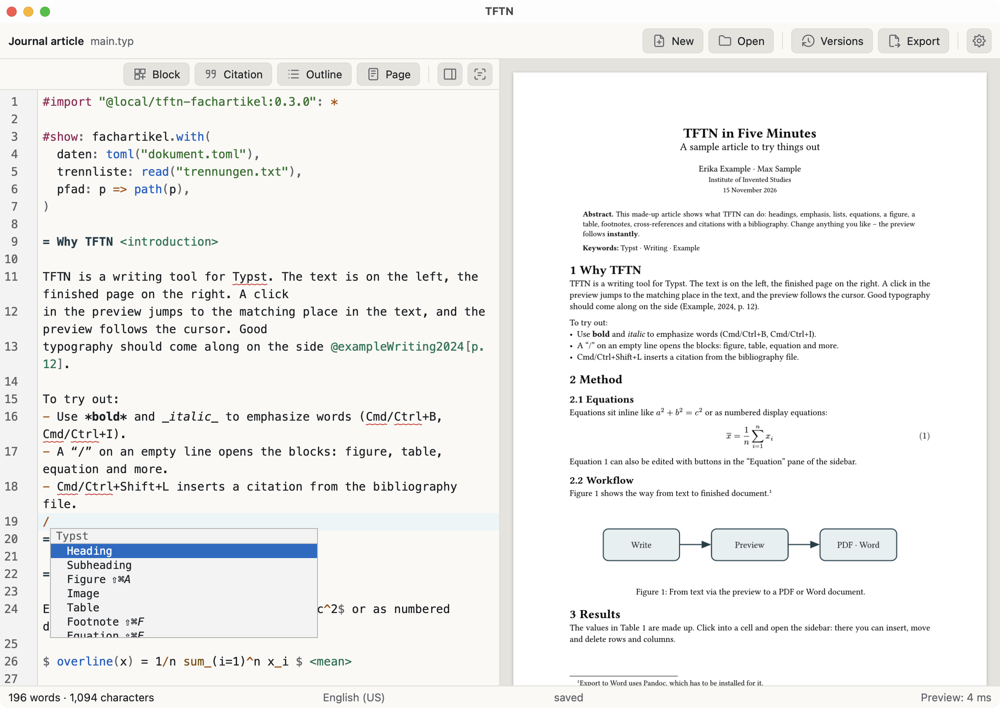
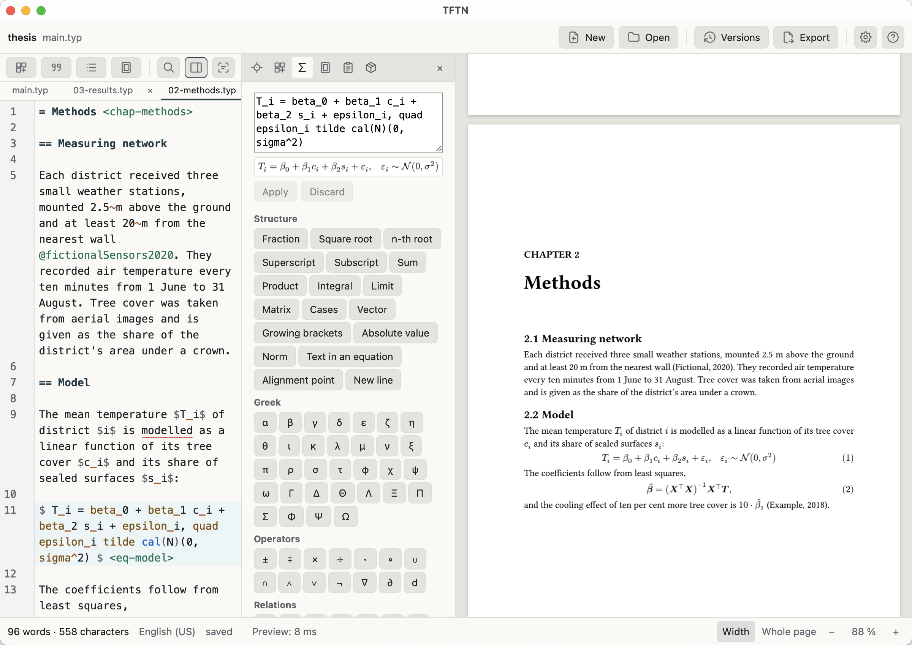
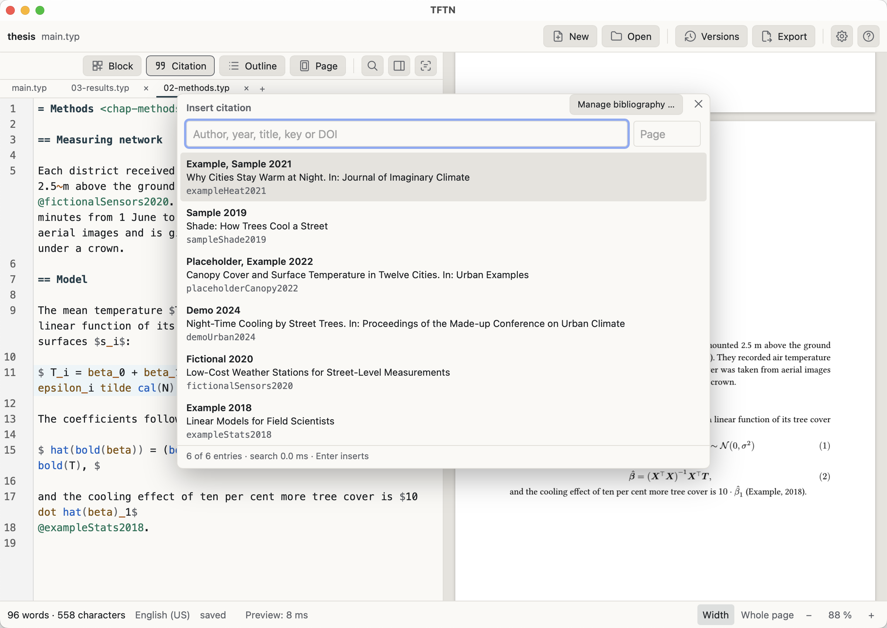
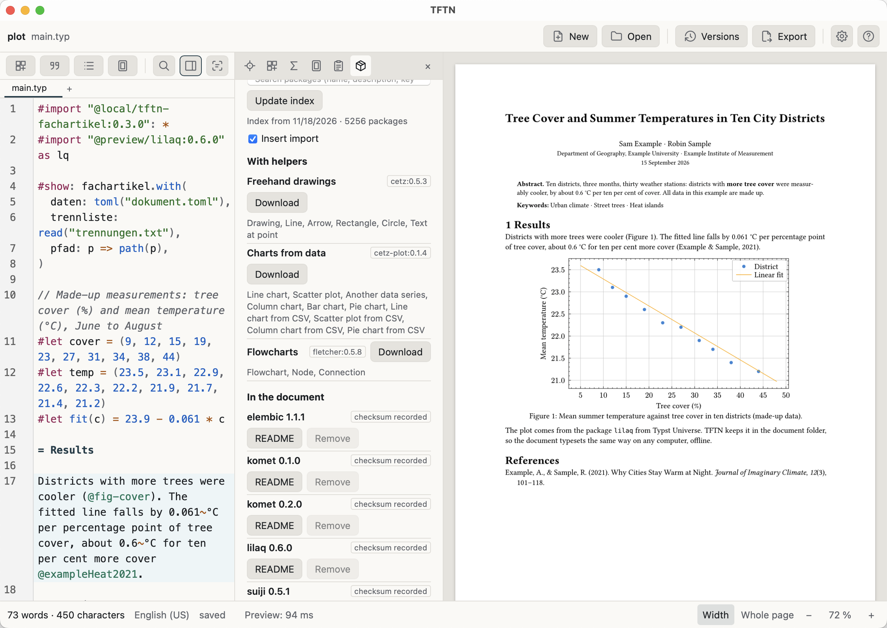
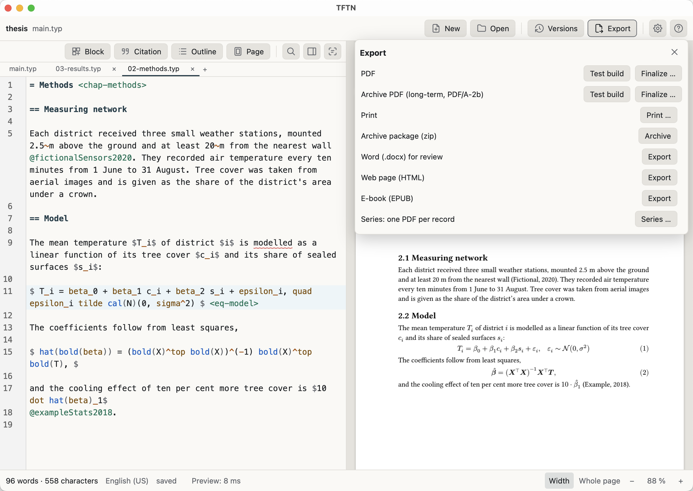
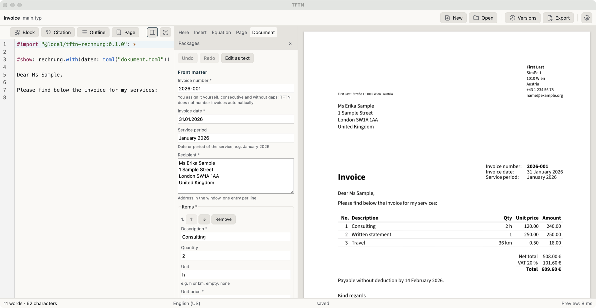
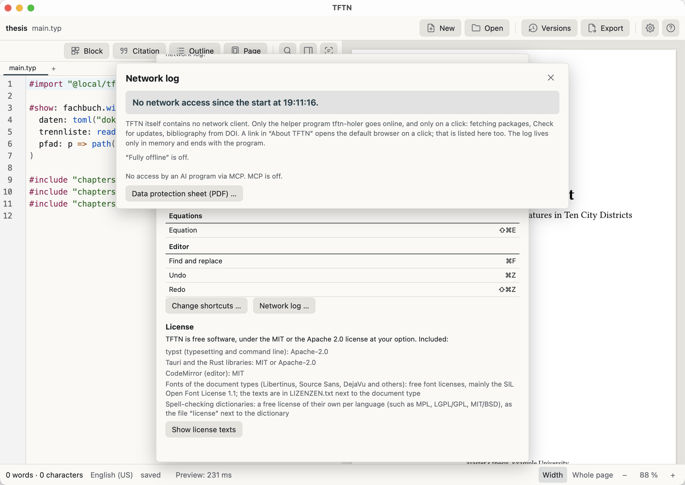

# TFTN – Typst for the Noobs (like me)


[](https://ko-fi.com/docatprompt)

A native, offline writing app for [Typst](https://typst.app) on macOS, Windows and Linux: write on the
left, see the finished page on the right as you type. Built with Rust, Tauri 2 and CodeMirror 6.



**Why offline, when Typst has an excellent web app?** Some texts must not leave your computer:
reports about patients or clients, legal and HR documents, anything covered by professional
secrecy or data protection law (such as the GDPR). TFTN keeps every document, every keystroke and
every preview on your own machine – no account, no cloud, no upload – so you can write such texts
with Typst without handing them to a third party.

- **Live preview with click-to-source** in both directions.
- **Guided tours** in “About TFTN”: “TFTN in a few minutes” and eight short tours on single topics,
  step by step or played with subtitles, on a copy with made-up data.
- **Blocks and completion** for figures, tables, equations, citations and more – type “/” on an empty
  line.
- **Your own text blocks:** standard phrases and paragraphs with gaps to fill in, kept in one file in
  your settings folder (synced to every computer if you like); select text and save it as a block
  with a right-click.
- **Long documents in chapters:** each `#include`d chapter file opens as a tab next to the main file,
  with its own undo; clicking text in the preview opens the right chapter, and writing
  `#include "chapters/new.typ"` creates the file for you.
- **Find and replace across the whole document:** search all chapter files at once (match case, whole word,
  regular expressions), jump to a match, replace in the editor with undo per file.
- **Change values without code:** markers, a context sidebar, a table grid and an equation palette.
- **Document types** as Typst packages, with a form for the front matter. TFTN ships a blank
  document, letter, invoice, medical report, report, journal article, book, poster and CV – and
  copies any of them into a custom type of your own in Settings. Letter, medical report and invoice
  take a logo and a scanned signature.
- **Any font, the same everywhere:** pick an installed font or a font file; TFTN copies the family
  into the document folder, so preview, export and every other computer typeset with the very same files.
  Missing characters (ß, umlauts, €, …) are flagged when you choose the font and wherever the text
  falls back to another font or an empty box.
- **Citations** from your BibTeX/BibLaTeX file, or straight from a DOI (Crossref, DataCite).
- **Bibliography manager:** browse, search, edit, add and delete entries of your `.bib` file in a
  form; only the changed entry is rewritten, everything else in the file stays as it was. Entries
  you have not cited yet are marked.
- **Comment overview:** every `//` and `/* */` comment listed under its heading – notes to yourself
  and review remarks in one place, one click away.
- **Preview zoom:** fit to width, whole page or any percentage, with scrollbars; ⌘/Ctrl + wheel or
  pinch zooms around the pointer.
- **Paste with conversion:** paste Markdown or formatted text from a browser, Word or a chat
  assistant and convert it to Typst with one click (via Pandoc).
- **Typst Universe packages** vendored into the document folder with checksums – documents build offline,
  on any machine.
- **Import** from Word, OpenDocument, Markdown, HTML, EPUB and LaTeX, **export** to PDF (incl.
  PDF/A), to Word for proofreading and to an e-book (EPUB, both via Pandoc) and to a
  self-contained web page (HTML).
- **Series for letters and invoices:** a CSV from Excel (columns matched to the form fields, umlauts
  from old Windows files included), one `.toml` with many records, or a folder of `.toml` files,
  run over the document – one PDF per record, or all in one PDF for a single print run (optionally
  with blank pages for double-sided printing). Each record holds only what changes; sender, bank
  and the rest come from the document.
- **Archive package:** one click puts the PDF/A, the source, every font and package used and a
  README with the exact `typst compile` command and the PDF's SHA-256 into a zip. The PDF is built
  from the zip's contents alone, so years later – without TFTN – the same typst version gives the
  same PDF, byte for byte.
- **Autosave with versions**, outline with drag-and-drop sections, spell checking, word count,
  distraction-free focus view, editor font size with ⌘/Ctrl + and −, printing with ⌘/Ctrl+P.
- **AI assistants via MCP** (opt-in): Claude Code or the agent of your choice – a local model
  included – can read and edit the open document in the running app; every change shows up at once
  and can be undone. Off by default; once you switch it on, the assistant you connect sees the
  document – with a cloud assistant it leaves your machine. **Incognito** keeps personal data out of
  it: names, dates of birth and insurance numbers from the form reach the assistant only as stand-in
  texts such as “[Female patient]” or “[born 1970]” (the page image too), and TFTN puts the real
  values back when the assistant writes. What TFTN does not know as a form field – a name only in
  the running text, a scan – is not replaced.
- **Skins and interface size:** light, dark, paper and high contrast, or your own; bars and dialogs
  scale from small to extra large.
- **Offline by design:** no network access except on explicit request, through one small helper
  with a fixed list of addresses. A **network log** shows every network access since the start –
  normally none – and prints a one-page sheet for your records or data protection officer. Your
  text stays plain Typst; `tftn gegenprobe` prints the `typst compile` command that produces the
  identical PDF without TFTN.
- **About TFTN** (F1, on the Mac ⌘?): version, licenses, links and every keyboard shortcut in effect at a glance.

Interface and bundled document types in English and German; more interface languages can be added
as plain files. New documents follow the interface language.

| | |
|---|---|
|  |  |
| Dark skin | Type “/” on an empty line for blocks – even ones from packages you have not downloaded yet |
|  |  |
| Equations: edit with a palette, rendered as you type | Citations: search your `.bib` file; “Manage bibliography” edits entries in a form |
|  |  |
| Packages from Typst Universe, kept in the document folder with checksums | Export: test PDF, PDF/A for the archive, Word, HTML, EPUB, one PDF per record |
|  |  |
| Document types with forms: an invoice, the totals are computed | Network log: proof that TFTN stays offline |

**Status:** early but usable day to day on macOS (Apple silicon). The Windows build passes the test
suite and an automated install check, but has hardly been used by hand yet. On Linux there is no
download yet: the app builds there in CI, and you can [build it yourself](#building-on-linux).

## Documentation

- [Manual (English)](docs/manual.md)
- [Handbuch (Deutsch)](docs/handbuch.md)
- [`demo/`](demo/) – a sample article to open in TFTN

## Install

Download from the [releases](https://github.com/DocAtPrompt/tftn/releases):

- **macOS** (Apple silicon): unzip `TFTN-<version>-macos-arm64.zip` and drag `TFTN.app` to
  `/Applications`. The app is not notarized: on first launch, right-click → “Open”.
- **Windows** (10/11, x64): run `TFTN-<version>-windows-x64-setup.exe`; it installs for the current
  user without admin rights. The installer is not signed: if SmartScreen warns, choose “More info” →
  “Run anyway”.
- **Linux** (x64, arm64): no download yet – [build it yourself](#building-on-linux), it takes four
  commands and produces a `.deb` (or an AppImage).

The matching typst CLI is bundled.

Optional: [Pandoc](https://pandoc.org) 3.1.2 or later for import, Word and EPUB export and paste conversion
(`brew install pandoc`, `winget install --id JohnMacFarlane.Pandoc`, `sudo apt install pandoc`).

## Build from source

| Tool | Version | Notes |
|---|---|---|
| Rust | 1.92.0 | pinned in `rust-toolchain.toml`, rustup installs it |
| Node.js | 26.12 LTS | pinned in `.nvmrc` |
| typst CLI | exactly 0.15.1 | `cargo xtask typst-holen` downloads and verifies it into `_lokal/`; or put it on `PATH` / in `TFTN_TYPST` |
| Pandoc | ≥ 3.1.2 | optional: import, Word and EPUB export |
| veraPDF + Java | ≥ 1.30 / ≥ 11 | optional: PDF/A checks in the tests |
| Windows | MSVC Build Tools, WebView2 | “Desktop development with C++” |
| Linux | WebKitGTK 4.1 and build tools | see [Building on Linux](#building-on-linux) |

```bash
npm ci
```

```bash
cargo xtask typst-holen
```

```bash
npx tauri dev
```

```bash
npm run buendel
```

`npx tauri dev` starts the app in development mode (`TFTN_PROJEKT=<folder>` opens a specific
project). `npm run buendel` builds `target/release/bundle/macos/TFTN.app` (release, ad-hoc signed).

### Building on Linux

**Why there is no Linux download yet:** TFTN is written for texts that have to be right – reports,
letters, invoices. The macOS app is used every day, and the Windows installer runs on a real PC and
passes an automated install check. For Linux we have neither yet: nobody on the project works on
Linux, and a package that merely builds can still fail on some distributions (WebKitGTK versions,
graphics drivers, FUSE for AppImages). We would rather not hand out something we have never seen
running. Building it yourself takes a few commands and produces a package for the system you
actually use. A ready-made AppImage will follow once the self-build has been tried by hand – reports
from Linux users (even an issue saying “works on Fedora 41”) bring that closer.

Until then, Linux users build TFTN themselves. The CI builds and tests the
app on Ubuntu 24.04 with every push; other distributions should work the same way. The first build
takes 15–30 minutes.

1. System packages (WebKitGTK and build tools), as listed by [Tauri](https://v2.tauri.app/start/prerequisites/#linux):

   ```bash
   sudo apt install libwebkit2gtk-4.1-dev build-essential curl wget file libxdo-dev libssl-dev libayatana-appindicator3-dev librsvg2-dev
   ```

   Fedora: `sudo dnf install webkit2gtk4.1-devel openssl-devel curl wget file libappindicator-gtk3-devel librsvg2-devel libxdo-devel` and `sudo dnf group install c-development`.
   Arch: `sudo pacman -S --needed webkit2gtk-4.1 base-devel curl wget file openssl appmenu-gtk-module libappindicator-gtk3 librsvg xdotool`.

2. [Rust via rustup](https://rustup.rs) (the version in `rust-toolchain.toml` is installed by itself)
   and Node.js in the version from `.nvmrc` (e.g. with [nvm](https://github.com/nvm-sh/nvm): `nvm install`).

3. In the source folder (`git clone https://github.com/DocAtPrompt/tftn && cd tftn`):

   ```bash
   npm ci
   ```

   ```bash
   cargo xtask typst-holen --nur-host
   ```

   ```bash
   npx tauri build --bundles deb --config src-tauri/tauri.buendel.json
   ```

   `typst-holen` downloads the official typst CLI and checks it against `xtask/typst-cli.sha256`.
   The last command builds a `.deb` with the typst CLI and the download helper inside.

4. Install it:

   ```bash
   sudo apt install ./target/release/bundle/deb/TFTN_*.deb
   ```

   Instead of a `.deb`, `--bundles appimage` builds a self-contained AppImage under
   `target/release/bundle/appimage/`; `--bundles rpm` builds an `.rpm` for Fedora.

On Linux, TFTN uses the Ctrl shortcuts like on Windows.

## Repository layout

| Path | Content |
|---|---|
| `crates/tftn-core` | preview world, incremental compile, click-to-source |
| `crates/tftn-edit` | value editing via the Typst syntax tree (patches) |
| `crates/tftn-katalog` | blocks, snippets, completion |
| `crates/tftn-literatur` | citations, DOI lookup |
| `crates/tftn-export`, `tftn-manifest`, `tftn-pakete` | export via the typst CLI, document types, package vendoring |
| `crates/tftn-holer` | the only program with network access (fixed addresses) |
| `crates/tftn-sprachen` | interface translations (`tr!`) |
| `crates/tftn-cli` | the `tftn` command line tool |
| `src-tauri/`, `ui/` | the app: Tauri shell and interface (TypeScript, CodeMirror 6) |
| `types/` | bundled document types (Typst packages) |
| `package-descriptions/` | descriptions of Universe packages with helpers (cetz, fletcher, cetz-plot) |
| `languages/` | interface language files (`en.toml`) |
| `dictionaries/` | Hunspell dictionaries, each with its license |
| `tests/korpus/` | test documents (synthetic), reference images, checksums |
| `demo/` | sample project |
| `xtask/` | build and check tasks |

Code, comments and identifiers are in German.

## Development

| Command | Purpose |
|---|---|
| `cargo xtask ci` | everything CI checks, locally and offline: UI build and tests, fmt, clippy, Rust tests, network isolation, checksums, visual regression (macOS) |
| `cargo test --workspace` | Rust tests (needs typst 0.15.1 on `PATH` or in `TFTN_TYPST`) |
| `npm test` | UI tests (vitest) |
| `cargo xtask referenzen` | visual regression against `tests/referenz/` |
| `cargo xtask sprachen` | sync `languages/en.toml` with the texts in the code |
| `cargo xtask typstyle [--check]` | format the bundled Typst sources |
| `cargo xtask messen` | measure keystroke-to-preview latency |

Every visible text is written in German in the code (`tr!("…")` in Rust, `t("…")` in TypeScript);
`cargo xtask sprachen` collects them and a test requires `languages/en.toml` to be complete.

## Command line

`tftn neu`, `check`, `build`, `export`, `serie`, `gegenprobe`, `katalog`, `typ-pruefen` – see the
[manual](docs/manual.md#12-command-line).

## Support

TFTN is free and stays free. If you'd like to help, [buy me a coffee on Ko-fi](https://ko-fi.com/docatprompt) –
it goes towards a signed Mac app, a website and a signed Windows installer. Bug reports and ideas in
the [issues](https://github.com/DocAtPrompt/tftn/issues) are just as welcome.

## License

TFTN is licensed under either of [MIT](LICENSE-MIT) or [Apache-2.0](LICENSE-APACHE), at your option.
Bundled third-party material keeps its own license, stored next to it: fonts (`LIZENZEN.txt` in the
`fonts`/`schriften` folders), dictionaries (`dictionaries/*/license`), the Typst packages in the
test corpus, and the typst CLI (Apache-2.0).
